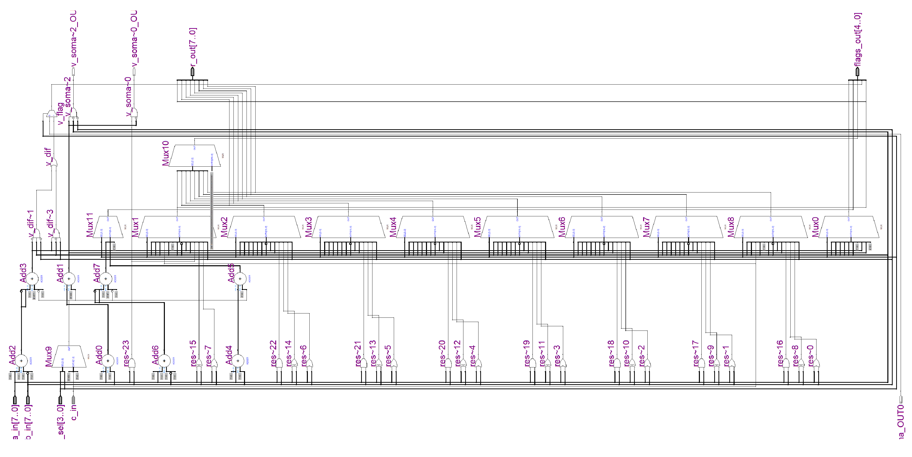

# Sistemas Reconfiguráveis — Trabalhos

Repositório destinado a reunir os trabalhos práticos desenvolvidos na disciplina de
**Sistemas Reconfiguráveis** do curso de **Engenharia de Computação** da
**Pontifícia Universidade Católica de Minas Gerais (PUC Minas)**.

O objetivo é manter, em um único lugar, tanto a **documentação** (relatórios técnicos em
LaTeX e seus PDFs) quanto o **código-fonte** dos projetos (descrições em VHDL), de forma
organizada por trabalho, permitindo consulta, versionamento e reprodução dos resultados.

Até o momento o repositório contém apenas o **TP1**.

## Conteúdo atual

| Trabalho | Tema | Status |
| --- | --- | --- |
| [TP1](TP1) | Unidade Lógica e Aritmética (ULA/ALU) de 8 bits em VHDL | Concluído |

---

## TP1 — Unidade Lógica e Aritmética (ULA) de 8 bits

O primeiro trabalho prático consiste no projeto, na simulação e na documentação de uma
**ULA combinacional de 8 bits**, descrita em **VHDL** e voltada a um **FPGA da Altera**.
O circuito executa **16 operações** (lógicas, aritméticas, de deslocamento e de rotação)
e gera **5 flags de status**.

### Especificação resumida

**Entradas:**

- `a_in[7..0]` — operando A
- `b_in[7..0]` — operando B (operações com dois operandos)
- `c_in` — carry de entrada (somas, subtrações com carry e rotações)
- `op_sel[3..0]` — seleção da operação

**Saídas:**

- `r_out[7..0]` — resultado
- `flags_out[4..0]` — flags na ordem `[0] N`, `[1] V`, `[2] Z`, `[3] H`, `[4] C`

**Operações (`op_sel`):**

| `op_sel` | Mnemônico | Operação |
| --- | --- | --- |
| 0000 | PASS_B | `r = b` |
| 0001 | OR | `r = a OR b` |
| 0010 | XOR | `r = a XOR b` |
| 0011 | AND | `r = a AND b` |
| 0100 | ADDC | `r = a + b + c_in` |
| 0101 | ADD | `r = a + b` |
| 0110 | SUBC | `r = a - b - c_in` |
| 0111 | SUB | `r = a - b` |
| 1000 | NOT | `r = NOT a` |
| 1001 | SRA | deslocamento aritmético à direita |
| 1010 | SRL | deslocamento lógico à direita |
| 1011 | SLL | deslocamento lógico à esquerda |
| 1100 | RRC | rotação à direita pelo carry |
| 1101 | RLC | rotação à esquerda pelo carry |
| 1110 | RR | rotação à direita |
| 1111 | RL | rotação à esquerda |

**Flags:** `C` (carry/borrow), `H` (half carry/borrow), `Z` (zero), `V` (overflow) e
`N` (negativo, cópia do bit 7 do resultado).

### Restrições de projeto

- Descrição em VHDL usando **exclusivamente código concorrente** (`<=`, `with-select`,
  `when-else`), **sem** comandos `process`.
- Circuito **puramente combinacional**, sem *latches* nem *flip-flops*.
- Entradas e saídas dos tipos `std_logic` e `std_logic_vector`.
- Um único **somador/subtrator de 8 bits** é compartilhado por ADDC, ADD, SUBC e SUB,
  usando subtração por complemento de dois (inversão do operando B e ajuste do carry).

### Estrutura em portas lógicas

A figura abaixo mostra o **mapa da ALU em portas lógicas**, evidenciando como o circuito
combinacional foi construído — o somador/subtrator compartilhado, a multiplexação das
operações e a lógica de geração das flags:



### Ferramentas

- **Quartus II 9.1sp2** (Altera) — síntese e simulação funcional (arquivos `.vwf`).
- **FPGA Altera Cyclone II** (dispositivo `EP2C35F672C6`) como plataforma de destino.
- Relatório produzido em **LaTeX** (classe `abntex2`).

### Projeto no Quartus

O projeto pronto para abrir no Quartus está em [`TP1/Quartus/`](TP1/Quartus), já com a
entidade de topo renomeada para `alu`. Os principais arquivos são:

- `alu.qpf` — arquivo de projeto (abrir no Quartus II);
- `alu.qsf` — atribuições do projeto (família, dispositivo, arquivos-fonte e restrições);
- `alu.qws` — layout de janelas do ambiente;
- `alu.vhd` — descrição VHDL compilada/simulada no Quartus;
- `alu.vwf` e `alu_*.vwf` — formas de onda, uma para cada operação (ex.: `alu_ADD.vwf`);
- `alu.*.rpt` / `*.summary` — relatórios de síntese, *fitting* e simulação;
- `alu.sof` / `alu.pof` — arquivos de programação do FPGA;
- `db/` e `incremental_db/` — bancos de dados **gerados** pela compilação (podem ser
  recriados pelo Quartus).

### Prints das simulações

A pasta [`TP1/Prints/`](TP1/Prints) reúne os **prints dos resultados das formas de onda**
(*waveforms*) obtidos na simulação funcional. Para **cada uma das 16 operações** da ULA
são capturados os **6 testes** definidos nas tabelas de casos de teste, resultando nos
**96 casos** totais cobertos pelo trabalho. Esses prints servem como evidência visual de
que a saída (`r_out` e `flags_out`) corresponde ao esperado para cada combinação de
entradas (`a_in`, `b_in`, `c_in` e `op_sel`). Há um arquivo por operação, nomeado com o
mnemônico correspondente (ex.: `ADD.png`, `PASS_B.png`, `RRC.png`).

Além das waveforms, a pasta contém a imagem **`Portas_Logicas.png`**, que apresenta o
**mapa da ALU em portas lógicas** (mostrado em
[Estrutura em portas lógicas](#estrutura-em-portas-lógicas)).

---

## Estrutura do repositório

```
.
├── README.md
└── TP1/
    ├── Codigo/
    │   └── alu.vhd                         # Código-fonte VHDL da ULA
    ├── Quartus/                            # Projeto Quartus II (pronto para abrir/compilar)
    │   ├── alu.qpf                         # Arquivo de projeto (abrir no Quartus)
    │   ├── alu.qsf                         # Atribuições do projeto
    │   ├── alu.vhd                         # Código VHDL usado no Quartus
    │   ├── alu.vwf, alu_*.vwf              # Formas de onda (uma por operação)
    │   ├── alu.*.rpt, *.summary            # Relatórios de síntese/fitting/simulação
    │   ├── alu.sof, alu.pof                # Arquivos de programação do FPGA
    │   ├── db/                             # Banco de dados de compilação (gerado)
    │   └── incremental_db/                 # Compilação incremental (gerado)
    ├── Prints/                             # Prints das waveforms (6 testes por operação)
    │   ├── <OPERACAO>.png                  # Uma imagem por operação (ex.: ADD.png, RRC.png)
    │   └── Portas_Logicas.png              # Mapa da ALU em portas lógicas
    ├── Relatorio.pdf                       # Relatório final compilado
    └── Latex-Sistemas-Reconfiguraveis-TP1/ # Fontes do relatório em LaTeX
        ├── Relatorio.tex                   # Documento principal
        ├── referencias.bib                 # Referências bibliográficas
        ├── capitulos/                      # Capítulos (introdução, especificação, etc.)
        ├── config/                         # Pacotes e configuração de PDF
        ├── image/                          # Figuras e formas de onda da simulação
        ├── tabelas/                        # Tabelas de casos de teste (Markdown)
        └── vhdl/
            └── alu.vhd                     # Cópia do código incluída no relatório
```

O relatório está dividido em introdução, fundamentação teórica, especificação da ULA,
implementação em VHDL, simulação e resultados (96 casos de teste) e conclusão, além do
apêndice com o código-fonte.

## Como reproduzir

1. Abra o **Quartus II 9.1sp2** e carregue o projeto
   [`TP1/Quartus/alu.qpf`](TP1/Quartus/alu.qpf) (o código-fonte `alu.vhd` também está
   disponível isoladamente em `TP1/Codigo/alu.vhd`).
2. Compile o projeto e execute a **simulação funcional** no editor de formas de onda
   (`.vwf`), aplicando os vetores de teste descritos nas
   [tabelas de casos de teste](TP1/Latex-Sistemas-Reconfiguraveis-TP1/tabelas/resultados_esperados.md).
   Os resultados obtidos podem ser conferidos com os prints em
   [`TP1/Prints/`](TP1/Prints), que registram os 6 testes de cada operação.
3. Para regenerar o relatório, compile o arquivo `TP1/Latex-Sistemas-Reconfiguraveis-TP1/Relatorio.tex`
   com uma distribuição LaTeX (pdfLaTeX + Biber).

## Autores

- Ariel Inácio Jordão Coelho
- Lucca Mendes Alves Pellegrini

**Disciplina:** Sistemas Reconfiguráveis — Engenharia de Computação, PUC Minas
**Professor:** Francisco Manoel Pinto Garcia
